# SITEMAP VÀ LUỒNG MÀN HÌNH – LÁ CHẮN SỐ

> Phiên bản 1.1 · 24/11/2026 · Nền tảng: ứng dụng web, giao diện ưu tiên điện thoại
> Đi kèm: [01_dac_ta_san_pham.md](01_dac_ta_san_pham.md) · [02_dac_ta_chuc_nang.md](02_dac_ta_chuc_nang.md)
> Mã màn (MH-xx) và mã chức năng (CN-xx) dùng thống nhất với hai tài liệu trên.

---

## 1. Sitemap tổng thể

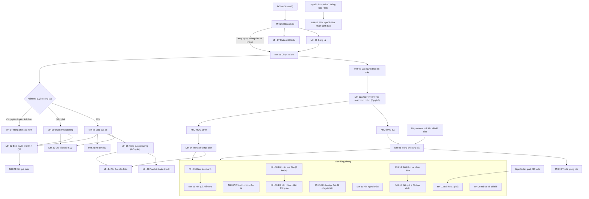

### 1.1 Cây trang và đường dẫn web

Mỗi màn có đường dẫn riêng. Người dùng mở thẳng được từ link hoặc thông báo, nút Quay lại của trình duyệt hoạt động đúng, và prototype có thể đi thẳng đến từng màn khi trình diễn.

```
/                         → đã đăng nhập hoặc đã chọn vai trò: về trang chủ theo vai trò; chưa thì /dang-nhap
├── /dang-nhap            MH-25 Đăng nhập (số điện thoại + mật khẩu, Google)
├── /dang-ky              MH-26 Đăng ký: ?b=1 số điện thoại · ?b=2 mã OTP · ?b=3 mật khẩu và tên
├── /quen-mat-khau        MH-27 Quên mật khẩu
├── /bat-dau              MH-01 Chọn vai trò
├── /nguoi-than           MH-02 Cài người thân tin cậy   (+ lớp phủ MH-02a)
│
├── /ong-ba               MH-03 Trang chủ Ông bà
│   └── /ong-ba/tro-ly    MH-19 Trợ lý giọng nói
├── /hoc-sinh             MH-04 Trang chủ Học sinh
│
├── /kiem-tra             MH-05 Kiểm tra nhanh     ?q=… (điền sẵn)
│   └── /kiem-tra/ket-qua MH-06 Kết quả kiểm tra   ?q=…
├── /tin-nhan             MH-07 Phân tích tin nhắn AI
├── /bao-cao              MH-08 Báo cáo (bước 1→3) ?tu=ket-qua (điền sẵn)
│   ├── /bao-cao/da-nhan  MH-09 Đã tiếp nhận + Gửi Công an
│   └── /khan-cap         MH-10 Tôi đã chuyển tiền
├── /hoi-nguoi-than       MH-11 Hỏi người thân (gửi + theo dõi)
├── /canh-bao/:ma         MH-12 Phía người thân (mở từ thông báo / SMS / Zalo)
│
├── /hoc                  MH-13 Thư viện 10 bài
│   └── /hoc/:tinhHuong   MH-13 Bài học 1 phút (T01–T10)
├── /thu-thach            MH-14 Bài kiểm tra nhận diện
│   └── /thu-thach/ket-qua MH-15 Kết quả + Chứng nhận
│
├── /doi                  MH-16 Tổng quan phường (thống kê kiểu lừa mới)
│   ├── /doi/xac-minh     MH-17 Hàng chờ xác minh
│   ├── /doi/tuyen-truyen MH-18 Tạo bài tuyên truyền
│   ├── /doi/buoi         MH-22 Buổi tuyên truyền: tạo buổi + mã QR
│   │   └── /doi/buoi/:ma MH-23 Kết quả buổi (cập nhật trực tiếp)
│   ├── /doi/do-dau       MH-21 Hộ đỡ đầu
│   └── /doi/xuat-bao-cao (hộp thoại trong MH-16)
│
├── /thi-dua              MH-24 Thi đua chi đoàn
├── /buoi/:ma             Người dân quét QR → MH-13 bài học → MH-14 (5 câu) → MH-15
├── /lien-ket/:ma         Máy của cụ: đồng ý liên kết đỡ đầu → MH-03
│
└── /toi                  MH-20 Hồ sơ và cài đặt
```

---

## 2. Điều hướng theo vai trò

### 2.1 Thanh điều hướng dưới cùng (điện thoại)

| Vai trò | Thẻ 1 | Thẻ 2 | Thẻ 3 | Thẻ 4 | Thẻ 5 |
|---|---|---|---|---|---|
| **Ông bà** (4 thẻ, cao 76px) | Trang chủ | Kiểm tra | Học | Tôi | – |
| **Học sinh** (5 thẻ) | Trang chủ | Kiểm tra | Học | Thử thách | Tôi |
| **Tình nguyện viên** | Việc của tôi | Tình hình | Tài liệu | Đỡ đầu | Tôi |
| **Điều phối viên** | Tổng quan | Kế hoạch | Thành viên | Báo cáo | Tôi |

Mỗi thẻ có một icon nét đơn sắc kèm nhãn chữ (DESIGN.md mục 1A, 8). Không dùng emoji.

- TNV vào buổi được giao từ MH-28/MH-30; vào tài liệu đã duyệt từ thẻ Tài liệu. Điều phối viên lập buổi từ Kế hoạch trong MH-29.
- **Thi đua chi đoàn** (MH-24): Học sinh vào từ thẻ **Thử thách**, Đội TNV vào từ khối thi đua trên MH-16.

- Thẻ **Kiểm tra** của Học sinh có hai phần chuyển qua lại: **[Số / Link / STK]** (MH-05) và **[Dán tin nhắn]** (MH-07).
- Với Ông bà, MH-07 không có thẻ riêng. App tự chuyển sang khi người dùng dán một đoạn văn dài (QT-06), hoặc khi bấm "Kể bằng giọng nói" (MH-19).
- Đội TNV vẫn dùng được các công cụ của người dân qua mục **Tôi → Công cụ người dân**.
- **Trên máy tính bảng và máy tính (≥ 768px)**, khu Đội TNV thay thanh dưới bằng **thanh bên trái**. MH-16 hiển thị 2–3 cột.

### 2.2 Thành phần có ở mọi màn

| Thành phần | Vị trí | Ghi chú |
|---|---|---|
| Nút Quay lại | Góc trên trái | Đồng bộ với nút Quay lại của trình duyệt |
| Nút 🔊 Nghe đọc | Góc trên phải | Có trên MH-06, MH-07, MH-11, MH-13, MH-14 |
| Dải mất mạng | Dưới thanh tiêu đề | "Đang dùng dữ liệu đã tải về lúc [giờ]" |
| Thanh điều hướng dưới | Đáy màn | Ẩn trong các luồng nhiều bước (MH-08, MH-14) để tập trung |

---

## 3. Luồng khởi đầu (F0)

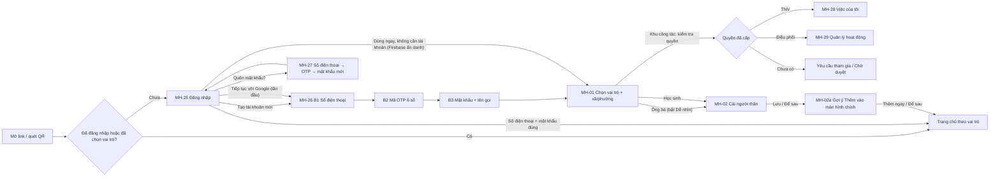

| Bước | Màn | Người dùng làm | Hệ thống phản hồi |
|---|---|---|---|
| 0a | MH-25 | Nhập số điện thoại + mật khẩu, hoặc "Tiếp tục với Google", hoặc "Dùng ngay, không cần tài khoản" | Đúng thì về trang chủ (đã có vai trò) hoặc MH-01. Sai 5 lần thì khóa 15 phút |
| 0b | MH-26 | B1 nhập số (reCAPTCHA vô hình) → B2 nhập mã OTP (đếm ngược gửi lại 60 giây) → B3 mật khẩu + tên gọi. Đang dùng ẩn danh thì dữ liệu được giữ lại khi tạo tài khoản. Google lần đầu: chỉ B1–B2, bỏ qua được trừ Đội TNV | Tạo tài khoản, chuyển MH-01 |
| 1 | MH-01 | Chọn thẻ vai trò, chọn xã/phường | Ông bà: tự bật Dễ nhìn và đọc lời chào. Chọn Đội TNV khi chưa đăng nhập thì yêu cầu đăng nhập |
| 2 | MH-02 | Thêm người thân (tên, số, quan hệ) hoặc "Để sau" | Người đầu tiên là người ưu tiên |
| 3 | MH-02a | "Thêm ngay" (xem hướng dẫn theo trình duyệt) hoặc "Để sau" | Không chặn, nhắc lại tối đa 2 lần |
| 4 | Trang chủ | – | Hiện "Bài học hôm nay" |

**Kiểm tra mà không cần khởi đầu (QT-01):** người mở thẳng link `/kiem-tra` được kiểm tra ngay. App chỉ hỏi vai trò khi người đó cần Hỏi người thân hoặc Báo cáo không ẩn danh.

---

> **Luồng chính (đã chốt)** là tập các luồng giải quyết yêu cầu đề: **F1, F2, F3, F4, F5, F6**, cộng hai luồng sáng tạo cho đoàn viên **F9, F10**. Mọi luồng từ F0 đến F10 (11 luồng) được làm hoàn chỉnh. Thứ tự trình diễn do đội quyết định.

## 4. Luồng Ông bà: kiểm tra số lạ và hỏi người thân (F1)

> Đi qua Bắt buộc 1 và Bắt buộc 3, cùng Điểm cộng 2.

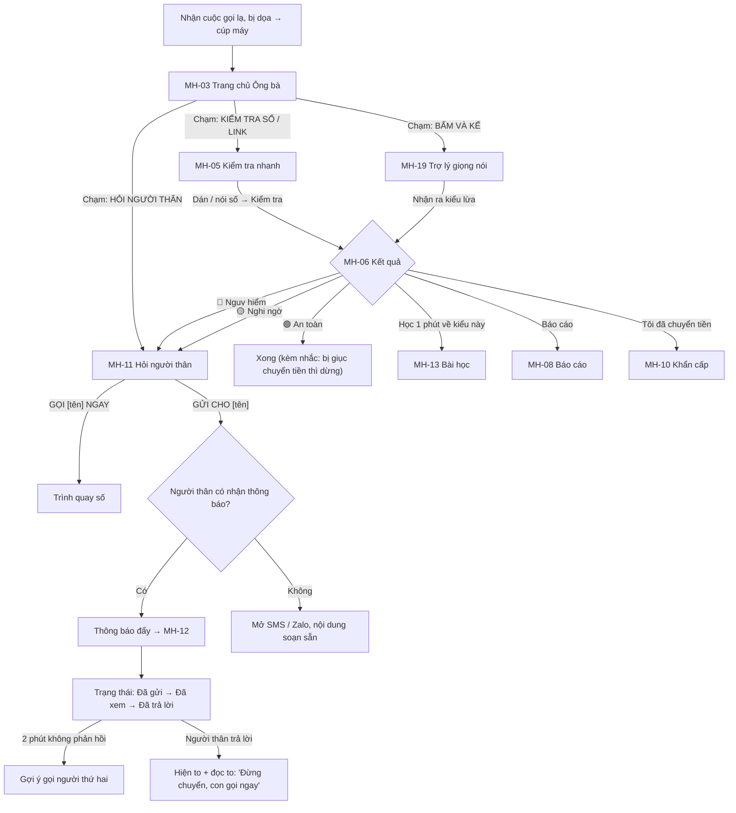

| # | Màn | Chạm | Nội dung chính trên màn |
|---|---|---|---|
| 1 | MH-03 | 1 | 3 nút cao 92px: **Kiểm tra số / link** · **Hỏi người thân** · **Bấm và kể** · thẻ "Bài học hôm nay" |
| 2 | MH-05 | 1–2 | Nút **Dán** to hoặc 🎤 nói số → **Kiểm tra** |
| 3 | MH-06 | – | Thẻ 🔴 **NGUY HIỂM** toàn chiều ngang · 3 lý do · **tự đọc to** · nút chính **HỎI NGƯỜI THÂN NGAY** |
| 4 | MH-11 | 1 | **Gọi Lan ngay** (đứng trước, QT-27) · **Gửi cho Lan** · xem trước tin soạn sẵn |
| 5 | MH-11 | – | Trạng thái gửi · câu trả lời của người thân hiện to và được đọc to |

**Tổng: từ kết quả đến khi người thân vào cuộc là 2 chạm (Gọi hoặc Gửi bằng thông báo), hoặc 3 chạm khi gửi qua SMS/Zalo.**

---

## 5. Luồng Học sinh: tin nhắn "việc nhẹ lương cao" (F2)

> Đi qua Điểm cộng 1 (AI), Bắt buộc 2, Bắt buộc 4, Bắt buộc 5.

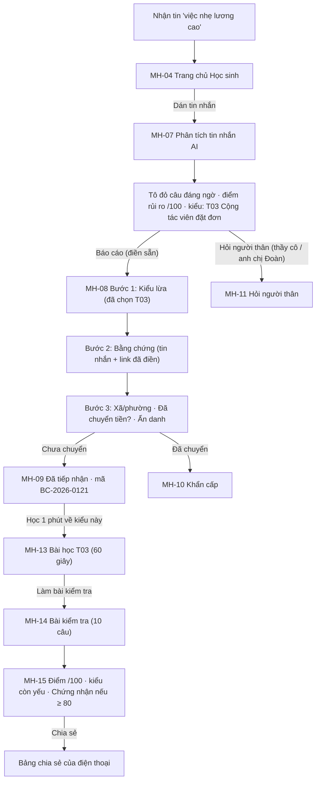

| # | Màn | Điểm nhấn thiết kế |
|---|---|---|
| 1 | MH-04 | Ô kiểm tra ở trên cùng · nút **Dán tin nhắn** · thẻ Thử thách · thi đua lớp · cảnh báo xã/phường |
| 2 | MH-07 | Câu đáng ngờ tô đỏ, chạm vào để xem giải thích · ghi chú "Đã che số tài khoản và họ tên trước khi phân tích" |
| 3 | MH-08 | Thanh bước 1/3–3/3 · dữ liệu điền sẵn · ẩn thanh điều hướng dưới |
| 4 | MH-09 | Mã báo cáo · trạng thái theo dõi · "Bạn là người thứ 121 tháng này" |
| 5 | MH-13 → MH-14 → MH-15 | Học đúng kiểu vừa gặp → kiểm tra → chứng nhận |

---

## 6. Luồng Báo cáo chi tiết (F3) – Bắt buộc 2

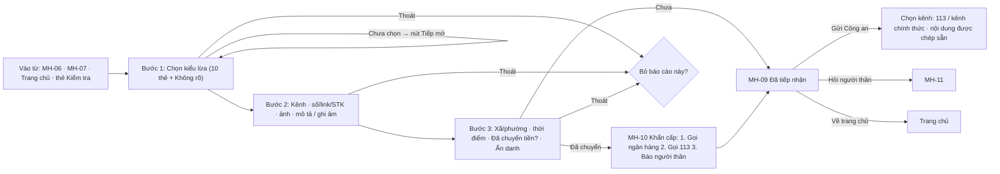

**Sau khi gửi, báo cáo đi tiếp như sau:** Đã nhận → xuất hiện trong **MH-17 Hàng chờ xác minh** của người có quyền duyệt cảnh báo tại xã/phường → Xác nhận / Bác bỏ / Chuyển Công an → trạng thái được cập nhật ở **MH-20 → Báo cáo của tôi**.

---

## 7. Luồng Hỏi người thân, hai phía (F4) – Bắt buộc 3

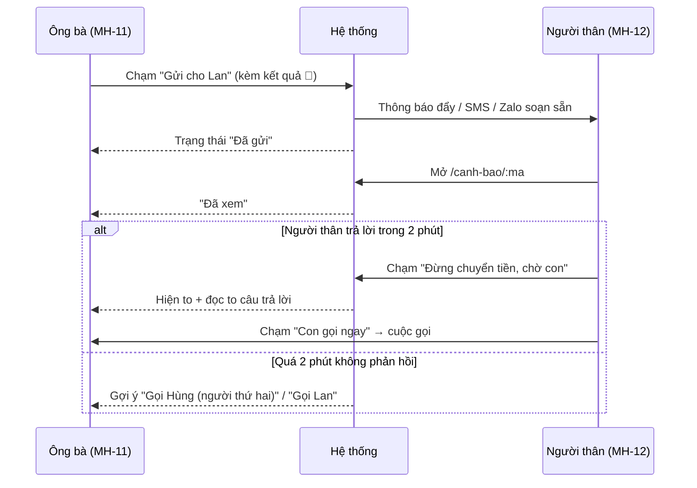

| Trường hợp | Xử lý |
|---|---|
| Chưa cài người thân | MH-11 → MH-02 → quay lại MH-11 đúng bước đang làm (QT-15) |
| Người thân chưa thêm web vào màn hình chính | Dùng SMS/Zalo. Trạng thái chỉ hiện "Đã mở tin nhắn", không theo dõi được Đã xem |
| Không có mạng | Ẩn "Gửi". Chỉ còn **Gọi ngay** |

---

## 8. Luồng Học và Kiểm tra (F5) – Bắt buộc 4, 5

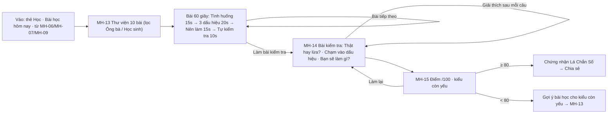

---

## 9. Luồng tuyên truyền và điều phối (F6)

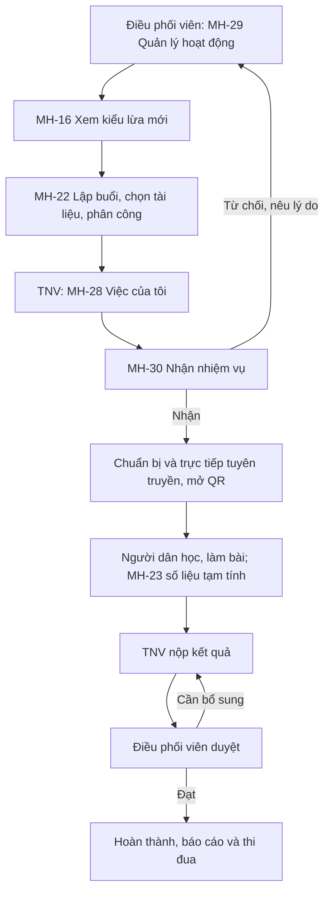

MH-16 vẫn phục vụ TNV xem tình hình địa phương tổng hợp để chọn nội dung phù hợp. MH-17 chỉ dành cho người được cấp quyền duyệt cảnh báo; quản lý hoạt động không tự có quyền này. TNV không xem bằng chứng cá nhân ngoài phạm vi được giao.

---

## 10. Luồng Khẩn cấp: đã chuyển tiền (F7)

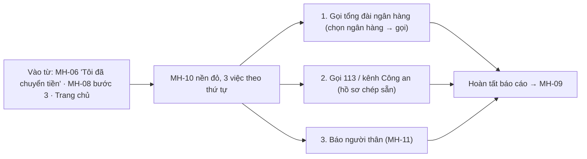

Từ MH-06 đến nút gọi ngân hàng: **2 chạm**.

---

## 11. Luồng Trợ lý giọng nói (F8) – Điểm cộng 2

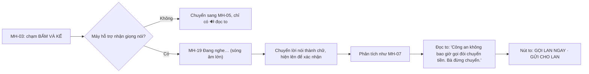

---

## 11A. Luồng Đoàn viên đỡ đầu số (F9)

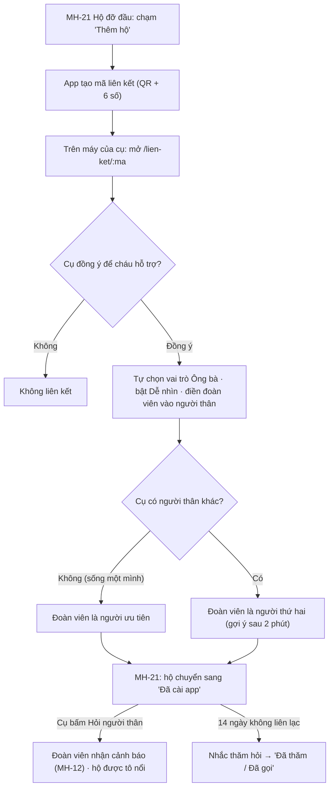

---

## 11B. Luồng Buổi tuyên truyền có QR (F10)

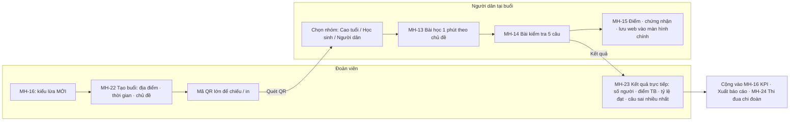

---

## 11C. Thi đua chi đoàn (trong F5 và F6)

```
Học sinh làm bài (MH-14) ─────┐
Buổi tuyên truyền (MH-23) ────┼──> MH-24 Thi đua chi đoàn
Hộ đỡ đầu (MH-21) ────────────┤    40% Kết quả học · 20% Tham gia
Hỗ trợ đã duyệt (MH-30) ───────┘    20% Tuyên truyền · 20% Hỗ trợ người dân
```

---

## 12. Ma trận màn hình

| Mã | Màn | Đường dẫn | Vào từ | Đi tới | Luồng |
|---|---|---|---|---|---|
| MH-25 | Đăng nhập | /dang-nhap | Lần đầu mở · chạm chức năng cần tài khoản · Tôi → Đăng nhập | Trang chủ · MH-01 · MH-26 · MH-27 | F0 |
| MH-26 | Đăng ký (3 bước) | /dang-ky | MH-25 (Tạo tài khoản, Google lần đầu) | MH-01 | F0 |
| MH-27 | Quên mật khẩu | /quen-mat-khau | MH-25 | MH-25 | F0 |
| MH-01 | Chọn vai trò | /bat-dau | MH-25 (Dùng ngay) · MH-26 · Tôi → Đổi vai trò | MH-02 · MH-16 | F0 |
| MH-02 | Cài người thân | /nguoi-than | MH-01 · MH-11 · MH-20 | MH-02a · quay lại MH-11 | F0, F4 |
| MH-02a | Gợi ý Thêm vào MH chính | lớp phủ | MH-02 | Trang chủ | F0 |
| MH-03 | Trang chủ Ông bà | /ong-ba | F0 · thẻ Trang chủ | MH-05 · MH-11 · MH-19 · MH-13 | F1 |
| MH-04 | Trang chủ Học sinh | /hoc-sinh | F0 · thẻ Trang chủ | MH-05 · MH-07 · MH-13 · MH-14 | F2 |
| **MH-05** | **Kiểm tra nhanh** | /kiem-tra | Trang chủ · thẻ Kiểm tra · link ngoài | MH-06 · MH-07 (văn bản dài) | F1 |
| **MH-06** | **Kết quả kiểm tra** | /kiem-tra/ket-qua | MH-05 · MH-19 | MH-11 · MH-08 · MH-13 · MH-10 | F1 |
| MH-07 | Phân tích tin nhắn AI | /tin-nhan | MH-04 · MH-05 · MH-19 | MH-11 · MH-08 · MH-13 | F2 |
| **MH-08** | **Báo cáo lừa đảo** | /bao-cao | MH-06 · MH-07 · Trang chủ | MH-09 · MH-10 | F3 |
| MH-09 | Đã tiếp nhận + Gửi Công an | /bao-cao/da-nhan | MH-08 · MH-10 | MH-11 · MH-13 · kênh Công an | F3 |
| MH-10 | Khẩn cấp | /khan-cap | MH-06 · MH-08 | Quay số · MH-11 · MH-09 | F7 |
| **MH-11** | **Hỏi người thân** | /hoi-nguoi-than | MH-03 · MH-06 · MH-07 · MH-09 · MH-10 | Quay số · SMS/Zalo · MH-02 | F1, F4 |
| MH-12 | Phía người thân | /canh-bao/:ma | Thông báo · SMS · Zalo | Quay số · trả lời nhanh | F4 |
| **MH-13** | **Bài học 1 phút** | /hoc, /hoc/:id | Thẻ Học · MH-06 · MH-07 · MH-09 · MH-15 | MH-14 · bài tiếp theo | F5 |
| **MH-14** | **Bài kiểm tra nhận diện** | /thu-thach | MH-13 · MH-04 · thẻ Thử thách | MH-15 | F5 |
| MH-15 | Kết quả + Chứng nhận | /thu-thach/ket-qua | MH-14 | MH-13 · làm lại · chia sẻ | F5 |
| **MH-16** | **Tổng quan phường** | /doi | F0 · thẻ Tổng quan | MH-17 · MH-18 · xuất PDF | F6 |
| MH-17 | Hàng chờ xác minh | /doi/xac-minh | Khu công tác, chỉ khi có quyền duyệt | Kênh Công an | F6 |
| MH-18 | Tạo bài tuyên truyền | /doi/tuyen-truyen | MH-16 · thẻ Tuyên truyền | Chia sẻ · trình chiếu MH-13 | F6 |
| MH-19 | Trợ lý giọng nói | /ong-ba/tro-ly | MH-03 | MH-06 · MH-11 | F8 |
| MH-20 | Hồ sơ và cài đặt | /toi | Thẻ Tôi | MH-01 · MH-02 · báo cáo của tôi | – |
| MH-21 | Hộ đỡ đầu | /doi/do-dau | Thẻ Đỡ đầu | Mã liên kết · MH-12 | F9 |
| MH-22 | Buổi tuyên truyền + QR | /doi/buoi | Thẻ Tuyên truyền · MH-16 | MH-23 | F10 |
| MH-23 | Kết quả buổi | /doi/buoi/:ma | MH-22 | MH-16 · MH-24 | F10 |
| MH-24 | Thi đua chi đoàn | /thi-dua | Thẻ Thử thách (HS) · MH-16 | MH-14 · MH-22 | F5, F6 |

---

## 13. Kiểm tra đủ yêu cầu của đề

| Yêu cầu | Màn | Luồng | Số chạm từ trang chủ |
|---|---|---|---|
| Kiểm tra nhanh, 3 mức kèm lý do | MH-05, MH-06 | F1 | 2–3 (mở → dán → kiểm tra) |
| Báo cáo một trường hợp | MH-08, MH-09 | F2, F3 | 4–5 (3 bước + gửi) |
| Nút "Hỏi người thân" | MH-11 | F1, F4 | **2** (Hỏi người thân → Gọi/Gửi) |
| Bài học 01 phút | MH-13 | F5 | 1–2 |
| Bài kiểm tra có chấm điểm | MH-14, MH-15 | F5 | 1–2 |
| Màn đội TNV: thống kê kiểu lừa mới | MH-16 | F6 | 1 (từ Việc của tôi → Tình hình) |
| Điểm cộng AI | MH-07, MH-18 | F2, F6 | 1–2 |
| Điểm cộng giọng nói | MH-19, 🔊 mọi màn | F1, F8 | 1 |
| Điểm cộng kênh Công an | MH-09, MH-10, MH-17 | F3, F6, F7 | – |
| Sáng tạo: Đoàn viên đỡ đầu số | MH-21 | F9 | 1 (thẻ Đỡ đầu) |
| Sáng tạo: Buổi tuyên truyền có QR | MH-22, MH-23 | F10 | 1–2 · người dân: quét QR là vào thẳng bài học |
| Sáng tạo: Thi đua chi đoàn | MH-24 | F5, F6 | 1–2 |
| Tài khoản: đăng nhập, đăng ký (số điện thoại + mật khẩu, Google) | MH-25, MH-26, MH-27 | F0 | Không chặn: "Dùng ngay, không cần tài khoản" |

---

## 14. Quyết định và điểm còn mở

**Đã chốt:** luồng chính là tập luồng giải quyết yêu cầu đề · 11 luồng F0–F10 làm hoàn chỉnh, thứ tự trình diễn do đội tự quyết · thêm F9 Đỡ đầu số, F10 Buổi tuyên truyền QR, Thi đua chi đoàn · người thân mẫu là **Lan** (con gái, ưu tiên) và **Hùng** (con trai) · chờ 2 phút rồi gợi ý người thứ hai · các ngưỡng nghiệp vụ như mục 16 của đặc tả chức năng.

**Còn mở:** đường dẫn web (mục 1.1) là đề xuất cho prototype, có thể đổi khi dựng.

## Điều hướng công tác bổ sung

| Màn | Đường dẫn | Vào từ | Đi tới |
|---|---|---|---|
| MH-28 Việc của tôi | /cong-tac | Đăng nhập có quyền TNV | MH-30, MH-16, tài liệu, hộ được giao |
| MH-29 Quản lý hoạt động | /dieu-phoi | Đăng nhập có quyền điều phối | MH-22, MH-30, MH-16 |
| MH-30 Chi tiết nhiệm vụ | /cong-tac/nhiem-vu/:id | MH-28/MH-29 | Nhận việc, buổi được giao, nộp/duyệt kết quả |

Kế hoạch, Thành viên, Báo cáo là các phần của MH-29. Tài liệu TNV là MH-18 với bản đã duyệt và bản nháp đề xuất. MH-22: điều phối viên tạo/sửa, TNV vận hành buổi được giao. MH-23: TNV xem buổi của mình, điều phối viên xem trong phạm vi quản lý.

F9 bắt đầu bằng điều phối viên phân công hộ, rồi TNV đề nghị liên kết và cụ đồng ý. F10 bắt đầu từ lập buổi/phân công ở MH-29/MH-22; TNV nhận việc tại MH-28/MH-30; sau buổi phải nộp và duyệt kết quả trước khi tính thành tích hoạt động.


## Quyết định phân cấp hoạt động

Nguồn: người dùng xác nhận trong phiên làm việc rằng tình nguyện viên là thành viên chi đoàn trực tiếp đi tuyên truyền; người quản lý hoạt động phải là vai trò cấp cao hơn riêng biệt. Tên “Điều phối viên” là tên đề xuất cho vai trò quản lý này.

- Người cao tuổi và Học sinh là nhóm trải nghiệm; TNV và Điều phối viên là quyền công tác được cấp. Một học sinh có thể đồng thời là TNV. Đổi giao diện không cấp thêm quyền.
- TNV nhận nhiệm vụ, dùng tài liệu đã duyệt, trực tiếp tuyên truyền, hỗ trợ hộ được giao và nộp kết quả.
- Điều phối viên lập kế hoạch, tạo buổi, phân công, duyệt tài liệu và kết quả, quản lý thành viên, tổng hợp báo cáo trong phạm vi được giao.
- Duyệt hoạt động không phải xác nhận lừa đảo. Quyền duyệt cảnh báo cấp riêng cho tài khoản được chỉ định; không mặc định thuộc TNV hoặc mọi điều phối viên.
- Người thân là quan hệ hỗ trợ có sự đồng ý. Người tham gia buổi là ngữ cảnh sử dụng, không cần một loại tài khoản riêng.
